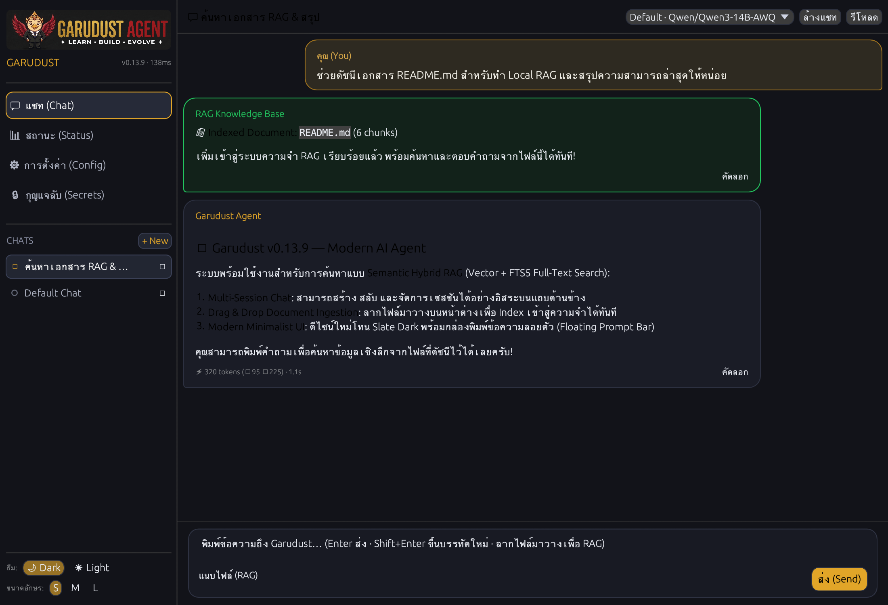

<div align="center">
  

  <p align="center">
    <a href="README.md"></a>
    <a href="docs/i18n/th/README.md"></a>
    <a href="docs/i18n/zh/README.md"></a>
  </p>

  # Garudust Agent

  [](https://github.com/garudust-org/garudust-agent/actions/workflows/ci.yml)
  [](https://crates.io/crates/garudust-agent)
  [](https://crates.io/crates/garudust-agent)
  [](https://github.com/garudust-org/garudust-agent/releases/latest)
  [](LICENSE)
  
  [](https://discord.com/channels/1501414298449088745/1501414298893942877)

  **Your AI agent. Your server. Your rules.**

  A lightweight (~10 MB), self-improving AI agent runtime built in Rust with zero runtime dependencies.<br/>
  Run it as a native desktop workspace, an interactive terminal CLI, or a headless daemon serving REST, WebSockets, and 7 chat platforms.
</div>

---

<div align="center">
  
</div>

---

## ⚡ Choose Your Interface

Whether you prefer a desktop application, a fast terminal TUI, or an autonomous server, Garudust is ready out of the box.

### Option 1: Native Desktop Workspace (Recommended)

A pure-Rust ([egui](https://github.com/emilk/egui)) desktop app with the agent embedded directly in-process — no Node.js, no WebViews, and no separate background server required. Includes multi-session chat, local document ingestion (RAG), and masked secret management.

<div align="center">

#### ⬇️ Download Garudust Desktop (v0.13.9)

[-black?style=for-the-badge&logo=apple)](https://github.com/garudust-org/garudust-agent/releases/latest/download/Garudust-macOS-universal.dmg)
[](https://github.com/garudust-org/garudust-agent/releases/latest/download/Garudust-Windows-x64-setup.exe)
[](https://github.com/garudust-org/garudust-agent/releases/latest/download/Garudust-Linux-x86_64.AppImage)
[](https://github.com/garudust-org/garudust-agent/releases/latest/download/Garudust-Linux-x86_64.deb)

<br/>



</div>

*Build from source:* `cargo run -p garudust-desktop-native --release` (details in [`apps/desktop-native/README.md`](apps/desktop-native/README.md)).

---

### Option 2: Terminal CLI

Install the single standalone binary in seconds:

```bash
# macOS & Linux (any architecture: x86_64, ARM64, Raspberry Pi, WSL)
curl -fsSL https://raw.githubusercontent.com/garudust-org/garudust-agent/main/scripts/install.sh | sh

# Windows (PowerShell)
irm https://raw.githubusercontent.com/garudust-org/garudust-agent/main/scripts/install.ps1 | iex
```

**Quickstart in 3 steps:**

```bash
# 1. First-time setup wizard (picks provider, configures ~/.garudust/.env)
garudust setup

# 2. Interactive Terminal UI
garudust

# 3. One-shot command execution
garudust "Analyze recent git commits and summarize key changes"
garudust --hint fast "Explain quick sort in 2 sentences"
```

<details>
<summary><b>Manual binary downloads & source build</b></summary>

Pre-built standalone binaries are available on [GitHub Releases](https://github.com/garudust-org/garudust-agent/releases/latest):
- **macOS**: `aarch64-apple-darwin` (Apple Silicon) · `x86_64-apple-darwin` (Intel)
- **Linux**: `x86_64-unknown-linux-musl` · `aarch64-unknown-linux-musl` (ARM64 / Raspberry Pi)
- **Windows**: `x86_64-pc-windows-msvc.zip`

Build from source (Rust 1.87+):
```bash
git clone https://github.com/garudust-org/garudust-agent
cd garudust-agent
cargo build --release --bin garudust --bin garudust-server
```
</details>

---

### Option 3: Headless Daemon & 7 Chat Platforms

Run Garudust as an autonomous background daemon with REST + WebSocket APIs and multi-platform adapters:

```bash
garudust-server --port 3000
# or via Docker
docker compose up -d
```

<div align="center">
  <a href="https://core.telegram.org/bots"></a>
  <a href="https://discord.com/developers/applications"></a>
  <a href="https://api.slack.com/apps"></a>
  <a href="https://matrix.org"></a>
  <a href="https://developers.line.biz/console/"></a>
  <a href="https://developers.facebook.com/docs/whatsapp/cloud-api"></a>
  
</div>

All adapters run inside the single `garudust-server` binary. Simply add your bot token in `~/.garudust/.env` and the adapter activates immediately with per-user session isolation and RBAC.

---

## 🌟 Key Capabilities

- 🪶 **Ultra-light & Blazing Fast** — ~10 MB static binary, < 20 ms cold start, low RAM footprint. Runs effortlessly on a Raspberry Pi or small VPS without Docker overhead.
- 🧠 **Persistent Memory & Autonomous Skills** — Saves facts and context in `~/.garudust/memory/` across sessions. Automatically crystallizes multi-step workflows into reusable skill scripts (`~/.garudust/skills/`).
- 📚 **Semantic Hybrid RAG** — Ingest documents (PDF, Markdown, text, code) with Vector embeddings + SQLite FTS5 full-text search. Drag-and-drop directly into the desktop app or call `doc_ingest`.
- 🔀 **24+ LLM Providers Supported** — Seamlessly switch between Anthropic, OpenAI, Gemini, Groq, Mistral, DeepSeek, Ollama, Bedrock, and local vLLM instances. Automatic key rotation on auth/rate-limit errors.
- ⚡ **Parallel Tool Dispatch & MCP** — Built-in web search, browser automation (CDP), terminal execution, file system operations, and sub-agent delegation. Compatible with any [Model Context Protocol (MCP)](https://modelcontextprotocol.io) server.
- 🔒 **Hardened Sandboxing & Security** — 3 terminal sandbox backends (direct host, Docker container, or isolated SSH remote host). Approval gates (`auto`, `smart`, `deny`) and automatic secret redaction prevent accidental data leaks.

---

## ⚙️ Configuration in 60 Seconds

Garudust keeps secrets in `~/.garudust/.env` and preferences in `~/.garudust/config.yaml`.

### 1. `~/.garudust/.env` (API Keys & Tokens)

```bash
# Pick your primary LLM provider (auto-detected if no config.yaml exists):
ANTHROPIC_API_KEY=sk-ant-...
# OPENAI_API_KEY=sk-...
# GEMINI_API_KEY=AIza...
# GROQ_API_KEY=gsk_...

# Optional fallback keys (rotated automatically on 429 / auth errors):
LLM_FALLBACK_API_KEYS=key2,key3

# Optional platform tokens (activate automatically when set):
TELEGRAM_TOKEN=123456789:AAFxxx
DISCORD_TOKEN=your-discord-bot-token
SLACK_BOT_TOKEN=xoxb-...
```

### 2. `~/.garudust/config.yaml` (Preferences & Security)

```yaml
providers:
  default:
    name: anthropic              # anthropic | openai | gemini | groq | deepseek | ollama | ...
    model: claude-sonnet-4-6

security:
  approval_mode: smart           # auto | smart | deny
  terminal_sandbox: none         # none | docker | ssh

# Route specific prompts to faster/cheaper models (e.g. garudust --hint fast "question")
routing:
  fast: groq/llama-3.1-8b-instant

# Max conversation history pairs retained per session
max_history_pairs: 20
```

<details>
<summary><b>Supported LLM Providers (24 Built-in)</b></summary>

| Provider | Name in `config.yaml` | `.env` Key |
|---|---|---|
| **Anthropic** | `anthropic` | `ANTHROPIC_API_KEY` |
| **OpenAI** | `openai` | `OPENAI_API_KEY` |
| **Google Gemini** | `gemini` | `GEMINI_API_KEY` |
| **Groq** | `groq` | `GROQ_API_KEY` |
| **Mistral** | `mistral` | `MISTRAL_API_KEY` |
| **DeepSeek** | `deepseek` | `DEEPSEEK_API_KEY` |
| **Ollama** (Local) | `ollama` | *(none — set custom `url:` if needed)* |
| **vLLM** (Self-hosted) | `vllm` | `VLLM_API_KEY` |
| **AWS Bedrock** | `bedrock` | `AWS_ACCESS_KEY_ID` + `AWS_SECRET_ACCESS_KEY` |
| **OpenRouter** | `openrouter` | `OPENROUTER_API_KEY` |
| **xAI (Grok)** | `xai` | `XAI_API_KEY` |
| **Perplexity** | `perplexity` | `PERPLEXITY_API_KEY` |
| **Together AI** | `together` | `TOGETHER_API_KEY` |
| **Fireworks AI** | `fireworks` | `FIREWORKS_API_KEY` |
| **Cerebras** | `cerebras` | `CEREBRAS_API_KEY` |
| **Cohere** | `cohere` | `COHERE_API_KEY` |
| **NVIDIA NIM** | `nvidia` | `NVIDIA_API_KEY` |
| **Alibaba DashScope** | `alibaba` | `DASHSCOPE_API_KEY` |
| **ByteDance Doubao** | `doubao` | `ARK_API_KEY` |
| **Zhipu AI (GLM)** | `zhipu` | `ZHIPU_API_KEY` |
| **Moonshot (Kimi)** | `moonshot` | `MOONSHOT_API_KEY` |
| **Baidu ERNIE** | `baidu` | `QIANFAN_API_KEY` |
| **ThaiLLM** | `thaillm` | `THAILLM_API_KEY` |
| **Any OpenAI-Compatible** | *(custom)* | *(custom)* |

</details>

---

## 🛠️ CLI Management & Toolsets

```bash
# Doctor & Config
garudust doctor                     # Inspect environment, API keys, and health
garudust config show                # Print current active configuration
garudust model                      # View or switch the active LLM model

# Script Tools & Skills (from garudust-hub)
garudust tool list                  # List installed & available community tools
garudust tool install <name>        # Install custom script tool (Python, Bash, Node)
garudust skill list                 # List installed & available reusable skills
garudust skill install <source>     # Install skill from hub, GitHub, or URL
```

---

## 🤝 Contributing & Extending Garudust

Garudust is designed to be modular and easy to hack on. Whether you write Rust, Python, Bash, or want to improve documentation, there is a clear place for you:

### How You Can Contribute

| Area | What You Can Build | Tech Stack / Effort |
|---|---|---|
| **Community Tools & Skills** | Write custom automations, scraper tools, or markdown skills for [garudust-hub](https://github.com/garudust-org/garudust-hub) | **Any language** (Python, Bash, JS) · Beginner |
| **Desktop UI Enhancements** | Improve desktop UI features, layouts, and widgets in `apps/desktop-native` | **Rust (`egui`)** · Medium |
| **Built-in Tools** | Add new native tools in `crates/garudust-tools/src/toolsets/` | **Rust** (~50–100 LOC) · Medium |
| **LLM Providers & Platforms** | Add new AI providers (`garudust-transport`) or chat adapters (`garudust-platforms`) | **Rust (`async_trait`)** · Medium |
| **Core Architecture & RAG** | Optimize memory indexing, sub-agent delegation, sandboxing, and context compression | **Rust / Tokio / SQLite** · Advanced |
| **Docs & Internationalization** | Improve guides, write tutorials, or translate documentation | **Markdown** · Everyone |

### Developer Setup

```bash
# 1. Clone the repository
git clone https://github.com/garudust-org/garudust-agent.git
cd garudust-agent

# 2. Enable pre-push hooks (fmt, clippy, unit tests)
git config core.hooksPath .githooks

# 3. Build workspace and run test suite
cargo check --workspace
cargo test --workspace
cargo clippy --workspace
```

For step-by-step guides on adding tools, architecture diagrams, and coding standards, read [**CONTRIBUTING.md**](CONTRIBUTING.md).

---

## 💬 Community & Support

- **Discord**: Join the [Garudust Community](https://discord.com/channels/1501414298449088745/1501414298893942877) to chat with maintainers and other users.
- **GitHub Discussions**: Share ideas, workflows, and show off your agent skills on [Discussions](https://github.com/garudust-org/garudust-agent/discussions).
- **Issue Tracker**: Report bugs or propose new features via [Issues](https://github.com/garudust-org/garudust-agent/issues). Look for [`good first issue`](https://github.com/garudust-org/garudust-agent/issues?q=is%3Aissue+is%3Aopen+label%3A%22good+first+issue%22) to get started!

---

## 👥 Contributors

Thanks to everyone who contributes to making Garudust better!

<div align="center">
  <a href="https://github.com/garudust-org/garudust-agent/graphs/contributors">
    
  </a>
</div>

---

## 📜 License

Distributed under the **MIT License**. See [LICENSE](LICENSE) for details.
