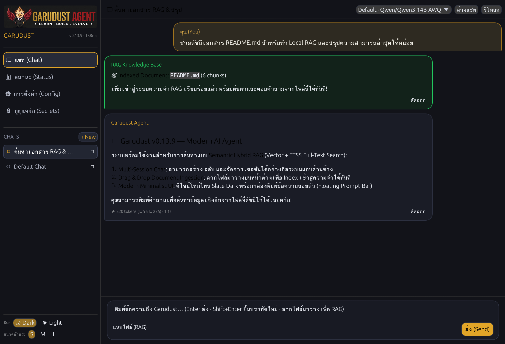

<div align="center">
  

  <p align="center">
    <a href="../../../README.md"></a>
    <a href="README.md"></a>
    <a href="../zh/README.md"></a>
  </p>

  # Garudust Agent

  [](https://github.com/garudust-org/garudust-agent/actions/workflows/ci.yml)
  [](https://crates.io/crates/garudust-agent)
  [](https://crates.io/crates/garudust-agent)
  [](https://github.com/garudust-org/garudust-agent/releases/latest)
  [](../../../LICENSE)
  
  [](https://discord.com/channels/1501414298449088745/1501414298893942877)

  **AI agent ของคุณ เซิร์ฟเวอร์ของคุณ กฎของคุณ**

  AI agent runtime ขนาดกะทัดรัด (~10 MB) พัฒนาด้วย Rust แบบ self-improving ไม่มี runtime dependency<br/>
  พร้อมใช้งานทั้งในรูปแบบแอปเดสก์ท็อปเนทีฟ, เทอร์มินัล CLI แบบโต้ตอบ หรือรันเป็นเซิร์ฟเวอร์เบื้องหลัง (Daemon) รองรับ REST, WebSocket และเชื่อมต่อ 7 แพลตฟอร์มแชท
</div>

---

<div align="center">
  
</div>

---

## ⚡ เลือกรูปแบบการใช้งาน

ไม่ว่าคุณจะต้องการใช้งานผ่านแอปเดสก์ท็อป, ทำงานอย่างรวดเร็วผ่าน Terminal TUI หรือเปิดรันเป็นเซิร์ฟเวอร์อัตโนมัติ Garudust พร้อมทำงานได้ทันที

### ทางเลือกที่ 1: แอปเดสก์ท็อปเนทีฟ (แนะนำ)

แอปพลิเคชันเดสก์ท็อปแบบ Pure-Rust ([egui](https://github.com/emilk/egui)) ที่ฝังระบบ Agent ลงในโปรเซสโดยตรง — ไม่ต้องใช้ Node.js, ไม่มี WebViews และไม่ต้องเปิดเซิร์ฟเวอร์แยก มาพร้อมระบบแชทแยกเซสชัน (Multi-session), การนำเข้าเอกสารทำความจำเฉพาะที่ (Local RAG) และระบบจัดการ Secret ที่ปลอดภัย

<div align="center">

#### ⬇️ ดาวน์โหลด Garudust Desktop (v0.13.9)

[-black?style=for-the-badge&logo=apple)](https://github.com/garudust-org/garudust-agent/releases/latest/download/Garudust-macOS-universal.dmg)
[](https://github.com/garudust-org/garudust-agent/releases/latest/download/Garudust-Windows-x64-setup.exe)
[](https://github.com/garudust-org/garudust-agent/releases/latest/download/Garudust-Linux-x86_64.AppImage)
[](https://github.com/garudust-org/garudust-agent/releases/latest/download/Garudust-Linux-x86_64.deb)

<br/>



</div>

*คอมไพล์จาก source code:* `cargo run -p garudust-desktop-native --release` (ดูรายละเอียดใน [`apps/desktop-native/README.md`](../../../apps/desktop-native/README.md)).

---

### ทางเลือกที่ 2: ใช้งานผ่าน Terminal CLI

ติดตั้งไฟล์ไบนารีเดี่ยวได้อย่างรวดเร็วในไม่กี่วินาที:

```bash
# macOS & Linux (รองรับทุกสถาปัตยกรรม: x86_64, ARM64, Raspberry Pi, WSL)
curl -fsSL https://raw.githubusercontent.com/garudust-org/garudust-agent/main/scripts/install.sh | sh

# Windows (PowerShell)
irm https://raw.githubusercontent.com/garudust-org/garudust-agent/main/scripts/install.ps1 | iex
```

**เริ่มต้นใช้งานใน 3 ขั้นตอน:**

```bash
# 1. รันตัวช่วยตั้งค่าครั้งแรก (เลือกโมเดลและสร้าง ~/.garudust/.env)
garudust setup

# 2. เข้าสู่โหมด Terminal UI แบบโต้ตอบ
garudust

# 3. สั่งงานแบบ One-shot คำสั่งเดียว
garudust "วิเคราะห์ประวัติ git commits ล่าสุดและสรุปจุดสำคัญ"
garudust --hint fast "อธิบายขั้นตอน Quick Sort สั้นๆ ใน 2 ประโยค"
```

<details>
<summary><b>ดาวน์โหลดไฟล์ไบนารีเอง หรือคอมไพล์จาก Source</b></summary>

ดาวน์โหลดไฟล์ไบนารีสำเร็จรูปได้จาก [GitHub Releases](https://github.com/garudust-org/garudust-agent/releases/latest):
- **macOS**: `aarch64-apple-darwin` (Apple Silicon) · `x86_64-apple-darwin` (Intel)
- **Linux**: `x86_64-unknown-linux-musl` · `aarch64-unknown-linux-musl` (ARM64 / Raspberry Pi)
- **Windows**: `x86_64-pc-windows-msvc.zip`

คอมไพล์จาก Source (Rust 1.87+):
```bash
git clone https://github.com/garudust-org/garudust-agent
cd garudust-agent
cargo build --release --bin garudust --bin garudust-server
```
</details>

---

### ทางเลือกที่ 3: รันเป็น Daemon หลังบ้าน & บอทแชท 7 แพลตฟอร์ม

รัน Garudust ในฐานะบริการเบื้องหลังอัตโนมัติ พร้อม REST + WebSocket APIs และอะแดปเตอร์เชื่อมต่อแชท:

```bash
garudust-server --port 3000
# หรือใช้งานผ่าน Docker
docker compose up -d
```

<div align="center">
  <a href="https://core.telegram.org/bots"></a>
  <a href="https://discord.com/developers/applications"></a>
  <a href="https://api.slack.com/apps"></a>
  <a href="https://matrix.org"></a>
  <a href="https://developers.line.biz/console/"></a>
  <a href="https://developers.facebook.com/docs/whatsapp/cloud-api"></a>
  
</div>

ทุกแพลตฟอร์มทำงานอยู่ภายในไฟล์ `garudust-server` เพียงตัวเดียว แค่ระบุ Token ของบอทใน `~/.garudust/.env` อะแดปเตอร์ของระบบนั้นจะเปิดใช้งานทันที พร้อมแยกเซสชันรายผู้ใช้และระบบกำหนดสิทธิ์ RBAC

---

## 🌟 จุดเด่นและฟีเจอร์สำคัญ

- 🪶 **ขนาดเล็กและทำงานรวดเร็ว** — ไฟล์ไบนารีสถิตขนาด ~10 MB, Cold Start < 20 ms, ประหยัดแรม สามารถรันบน Raspberry Pi หรือ VPS ขนาดเล็กได้อย่างราบรื่น
- 🧠 **ความจำถาวรและพัฒนาทักษะตนเอง (Self-Improving)** — บันทึกข้อเท็จจริงและบริบทไว้ใน `~/.garudust/memory/` ข้ามเซสชัน และสกัดขั้นตอนการทำงานที่ซับซ้อนเป็นสคริปต์ทักษะที่นำกลับมาใช้ใหม่ได้อัตโนมัติ (`~/.garudust/skills/`)
- 📚 **Semantic Hybrid RAG** — ดัชนีเอกสาร (PDF, Markdown, ข้อความ, โค้ด) ด้วย Vector Embeddings ผสานการค้นหาข้อความเต็มรูปแบบ SQLite FTS5 ลากไฟล์มาวางในแอปเดสก์ท็อป หรือเรียกผ่านคำสั่ง `doc_ingest`
- 🔀 **รองรับ 24+ ผู้ให้บริการ LLM** — สลับใช้งานระหว่าง Anthropic, OpenAI, Gemini, Groq, Mistral, DeepSeek, Ollama, Bedrock และ vLLM ได้ทันที พร้อมระบบสลับคีย์สำรองอัตโนมัติเมื่อเกิดข้อผิดพลาด
- ⚡ **ประมวลผลเครื่องมือคู่ขนานและ MCP** — มาพร้อมเครื่องมือค้นหาเว็บ, เบราว์เซอร์อัตโนมัติ (CDP), เทอร์มินัล, ระบบไฟล์ และการกระจายงานให้ Sub-agent รองรับโปรโตคอล [Model Context Protocol (MCP)](https://modelcontextprotocol.io)
- 🔒 **ระบบความปลอดภัยและการกักกัน (Sandbox)** — มี 3 โหมดกักกันคำสั่งเทอร์มินัล (บนเครื่องโดยตรง, ใน Docker Container, หรือบนเซิร์ฟเวอร์ปลายทางผ่าน SSH) พร้อมระบบขออนุมัติก่อนทำคำสั่งอันตราย และเซ็นเซอร์ความลับก่อนส่งให้ AI เสมอ

---

## ⚙️ ตั้งค่าพร้อมใช้งานใน 60 วินาที

Garudust เก็บข้อมูลความลับไว้ใน `~/.garudust/.env` และการตั้งค่าระบบใน `~/.garudust/config.yaml`

### 1. `~/.garudust/.env` (API Keys และ Tokens)

```bash
# เลือกผู้ให้บริการ LLM หลักที่ต้องการ (ตรวจจับอัตโนมัติหากไม่มี config.yaml):
ANTHROPIC_API_KEY=sk-ant-...
# OPENAI_API_KEY=sk-...
# GEMINI_API_KEY=AIza...
# GROQ_API_KEY=gsk_...

# คีย์สำรอง (จะสลับอัตโนมัติเมื่อติด Rate Limit หรือ Auth Error):
LLM_FALLBACK_API_KEYS=key2,key3

# Token ของแพลตฟอร์มแชท (จะเปิดใช้งานอัตโนมัติเมื่อระบุ):
TELEGRAM_TOKEN=123456789:AAFxxx
DISCORD_TOKEN=your-discord-bot-token
SLACK_BOT_TOKEN=xoxb-...
```

### 2. `~/.garudust/config.yaml` (การตั้งค่าทั่วไปและความปลอดภัย)

```yaml
providers:
  default:
    name: anthropic              # anthropic | openai | gemini | groq | deepseek | ollama | ...
    model: claude-sonnet-4-6

security:
  approval_mode: smart           # auto | smart | deny
  terminal_sandbox: none         # none | docker | ssh

# กำหนดเส้นทางให้คำสั่งบางประเภทใช้โมเดลที่เร็ว/ประหยัดกว่า (เช่น garudust --hint fast "คำถาม")
routing:
  fast: groq/llama-3.1-8b-instant

# จำนวนคู่ประวัติการสนทนาที่จำในแต่ละเซสชัน
max_history_pairs: 20
```

<details>
<summary><b>ผู้ให้บริการ LLM ทั้ง 24 รายการที่รองรับ</b></summary>

| ผู้ให้บริการ (Provider) | ค่า `name` ใน `config.yaml` | คีย์ใน `.env` |
|---|---|---|
| **Anthropic** | `anthropic` | `ANTHROPIC_API_KEY` |
| **OpenAI** | `openai` | `OPENAI_API_KEY` |
| **Google Gemini** | `gemini` | `GEMINI_API_KEY` |
| **Groq** | `groq` | `GROQ_API_KEY` |
| **Mistral** | `mistral` | `MISTRAL_API_KEY` |
| **DeepSeek** | `deepseek` | `DEEPSEEK_API_KEY` |
| **Ollama** (Local) | `ollama` | *(ไม่ต้องระบุ — เพิ่ม `url:` หากใช้พอร์ตอื่น)* |
| **vLLM** (Self-hosted) | `vllm` | `VLLM_API_KEY` |
| **AWS Bedrock** | `bedrock` | `AWS_ACCESS_KEY_ID` + `AWS_SECRET_ACCESS_KEY` |
| **OpenRouter** | `openrouter` | `OPENROUTER_API_KEY` |
| **xAI (Grok)** | `xai` | `XAI_API_KEY` |
| **Perplexity** | `perplexity` | `PERPLEXITY_API_KEY` |
| **Together AI** | `together` | `TOGETHER_API_KEY` |
| **Fireworks AI** | `fireworks` | `FIREWORKS_API_KEY` |
| **Cerebras** | `cerebras` | `CEREBRAS_API_KEY` |
| **Cohere** | `cohere` | `COHERE_API_KEY` |
| **NVIDIA NIM** | `nvidia` | `NVIDIA_API_KEY` |
| **Alibaba DashScope** | `alibaba` | `DASHSCOPE_API_KEY` |
| **ByteDance Doubao** | `doubao` | `ARK_API_KEY` |
| **Zhipu AI (GLM)** | `zhipu` | `ZHIPU_API_KEY` |
| **Moonshot (Kimi)** | `moonshot` | `MOONSHOT_API_KEY` |
| **Baidu ERNIE** | `baidu` | `QIANFAN_API_KEY` |
| **ThaiLLM** | `thaillm` | `THAILLM_API_KEY` |
| **ผู้ให้บริการอื่นที่เข้ากันได้กับ OpenAI** | *(กำหนดเอง)* | *(กำหนดเอง)* |

</details>

---

## 🛠️ การจัดการคำสั่งและเครื่องมือผ่าน CLI

```bash
# ตรวจสอบสภาพแวดล้อมและการตั้งค่า
garudust doctor                     # ตรวจสอบสถานะระบบ การเชื่อมต่อ และ API keys
garudust config show                # แสดงการตั้งค่าปัจจุบัน
garudust model                      # ดูหรือสลับโมเดล LLM ที่กำลังใช้งาน

# จัดการ Script Tools และ Skills (จาก garudust-hub)
garudust tool list                  # แสดงรายการเครื่องมือที่ติดตั้งและมีในชุมชน
garudust tool install <name>        # ติดตั้งเครื่องมือสคริปต์ (Python, Bash, Node)
garudust skill list                 # แสดงรายการทักษะที่พร้อมใช้งาน
garudust skill install <source>     # ติดตั้งทักษะจาก hub, GitHub หรือ URL
```

---

## 🤝 ร่วมพัฒนาต่อยอด Garudust (Contributing)

Garudust ถูกออกแบบให้เป็นระบบแยกโมดูล (Modular) เพื่อให้ง่ายต่อการต่อยอด ไม่ว่าคุณจะถนัดเขียน Rust, Python, Bash หรือต้องการช่วยปรับปรุงเอกสาร มีพื้นที่สำหรับคุณเสมอ:

### สายงานที่คุณสามารถร่วมพัฒนาได้

| ส่วนงาน | สิ่งที่คุณสามารถสร้างหรือพัฒนา | เทคโนโลยี / ระดับความยาก |
|---|---|---|
| **เครื่องมือและทักษะชุมชน** | เขียนระบบอัตโนมัติ, สคริปต์ดึงข้อมูล หรือคำสั่ง Markdown ลงบน [garudust-hub](https://github.com/garudust-org/garudust-hub) | **ภาษาใดก็ได้** (Python, Bash, JS) · ผู้เริ่มต้น |
| **พัฒนาหน้าตา Desktop UI** | เพิ่มฟีเจอร์ ปรับ Layout และ Widget ของแอปเดสก์ท็อปใน `apps/desktop-native` | **Rust (`egui`)** · ปานกลาง |
| **เครื่องมือในตัว (Built-in Tools)** | เพิ่มเครื่องมือใหม่ในระดับเนทีฟที่ `crates/garudust-tools/src/toolsets/` | **Rust** (~50–100 บรรทัด) · ปานกลาง |
| **ผู้ให้บริการ LLM และแพลตฟอร์ม** | เพิ่มค่าย AI ใหม่ (`garudust-transport`) หรืออะแดปเตอร์แชท (`garudust-platforms`) | **Rust (`async_trait`)** · ปานกลาง |
| **Core Architecture & RAG** | ปรับปรุงระบบความจำ, Sub-agent, ระบบ Sandbox และการบีบอัด Context | **Rust / Tokio / SQLite** · ขั้นสูง |
| **เอกสารและการแปลภาษา** | ปรับปรุงคู่มือการใช้งาน, เขียน Tutorial หรือแปลภาษาเอกสาร | **Markdown** · สำหรับทุกคน |

### การเตรียมสภาพแวดล้อมสำหรับนักพัฒนา

```bash
# 1. Clone คลังเก็บโค้ด
git clone https://github.com/garudust-org/garudust-agent.git
cd garudust-agent

# 2. เปิดใช้งาน Pre-push hooks (ตรวจสอบ fmt, clippy, unit tests ก่อน push)
git config core.hooksPath .githooks

# 3. ตรวจสอบการคอมไพล์และรันชุดทดสอบ
cargo check --workspace
cargo test --workspace
cargo clippy --workspace
```

อ่านแนวทางการเขียนโค้ดและขั้นตอนอย่างละเอียดได้ที่ [**CONTRIBUTING.md**](../../../CONTRIBUTING.md)

---

## 💬 ชุมชนและการสนับสนุน

- **Discord**: พูดคุยกับทีมผู้ดูแลและผู้ใช้งานคนอื่น ๆ ได้ที่ [Garudust Community](https://discord.com/channels/1501414298449088745/1501414298893942877)
- **GitHub Discussions**: แลกเปลี่ยนไอเดียและแบ่งปันการใช้งานได้ที่ [Discussions](https://github.com/garudust-org/garudust-agent/discussions)
- **แจ้งปัญหาหรือเสนอแนะ**: ส่งรายงานบั๊กหรือขอฟีเจอร์ใหม่ได้ที่ [Issues](https://github.com/garudust-org/garudust-agent/issues) ค้นหาแท็ก [`good first issue`](https://github.com/garudust-org/garudust-agent/issues?q=is%3Aissue+is%3Aopen+label%3A%22good+first+issue%22) เพื่อเริ่มมีส่วนร่วมได้ทันที!

---

## 👥 ผู้ร่วมพัฒนา (Contributors)

ขอขอบคุณทุกท่านที่มีส่วนร่วมพัฒนา Garudust ให้ดียิ่งขึ้น!

<div align="center">
  <a href="https://github.com/garudust-org/garudust-agent/graphs/contributors">
    
  </a>
</div>

---

## 📜 สัญญาอนุญาต (License)

เผยแพร่ภายใต้สัญญาอนุญาต **MIT License** ดูรายละเอียดได้ที่ไฟล์ [LICENSE](../../../LICENSE)
