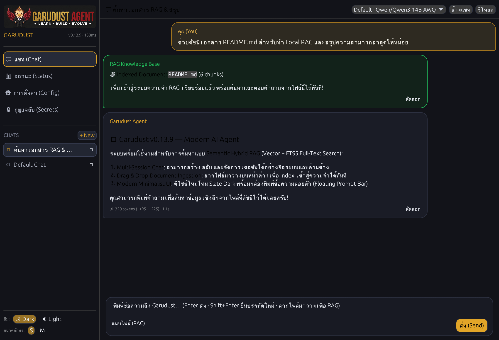

<div align="center">
  

  <p align="center">
    <a href="../../../README.md"></a>
    <a href="../th/README.md"></a>
    <a href="README.md"></a>
  </p>

  # Garudust Agent

  [](https://github.com/garudust-org/garudust-agent/actions/workflows/ci.yml)
  [](https://crates.io/crates/garudust-agent)
  [](https://crates.io/crates/garudust-agent)
  [](https://github.com/garudust-org/garudust-agent/releases/latest)
  [](../../../LICENSE)
  
  [](https://discord.com/channels/1501414298449088745/1501414298893942877)

  **你的 AI Agent。你的服务器。你的规则。**

  一个纯 Rust 构建的极轻量 (~10 MB)、自进化 AI Agent 运行时，零外部运行时依赖。<br/>
  既可作为原生桌面端应用运行，也可作为交互式终端 CLI，或作为后台守护进程提供 REST、WebSocket 服务及接入 7 大聊天平台。
</div>

---

<div align="center">
  
</div>

---

## ⚡ 选择适合你的运行方式

无论你青睐原生桌面应用、高效的终端 TUI，还是自主运行的后台服务器，Garudust 均可开箱即用。

### 方式 1: 原生桌面工作区 (推荐)

采用纯 Rust ([egui](https://github.com/emilk/egui)) 构建的原生桌面应用，Agent 引擎同进程内嵌运行 —— 无需 Node.js、无需 WebView、无需额外启动后台服务。支持多会话管理、本地文档拖拽建库 (RAG) 以及安全的机密密钥管理。

<div align="center">

#### ⬇️ 下载 Garudust 桌面端 (v0.13.9)

[-black?style=for-the-badge&logo=apple)](https://github.com/garudust-org/garudust-agent/releases/latest/download/Garudust-macOS-universal.dmg)
[](https://github.com/garudust-org/garudust-agent/releases/latest/download/Garudust-Windows-x64-setup.exe)
[](https://github.com/garudust-org/garudust-agent/releases/latest/download/Garudust-Linux-x86_64.AppImage)
[](https://github.com/garudust-org/garudust-agent/releases/latest/download/Garudust-Linux-x86_64.deb)

<br/>



</div>

*从源码构建:* `cargo run -p garudust-desktop-native --release` (详见 [`apps/desktop-native/README.md`](../../../apps/desktop-native/README.md))。

---

### 方式 2: 终端 CLI

一行命令快速安装单文件独立二进制：

```bash
# macOS 与 Linux (支持任何架构: x86_64, ARM64, 树莓派 Raspberry Pi, WSL)
curl -fsSL https://raw.githubusercontent.com/garudust-org/garudust-agent/main/scripts/install.sh | sh

# Windows (PowerShell)
irm https://raw.githubusercontent.com/garudust-org/garudust-agent/main/scripts/install.ps1 | iex
```

**三步快速上手:**

```bash
# 1. 首次配置向导 (选择模型服务商并写入 ~/.garudust/.env)
garudust setup

# 2. 启动交互式终端界面 (TUI)
garudust

# 3. 单次指令执行 (One-shot)
garudust "分析近期 git 提交记录并总结关键变化"
garudust --hint fast "用两句话解释快速排序"
```

<details>
<summary><b>手动下载二进制或源码编译</b></summary>

可直接从 [GitHub Releases](https://github.com/garudust-org/garudust-agent/releases/latest) 下载预编译二进制：
- **macOS**: `aarch64-apple-darwin` (Apple Silicon) · `x86_64-apple-darwin` (Intel)
- **Linux**: `x86_64-unknown-linux-musl` · `aarch64-unknown-linux-musl` (ARM64 / 树莓派)
- **Windows**: `x86_64-pc-windows-msvc.zip`

从源码构建 (需要 Rust 1.87+):
```bash
git clone https://github.com/garudust-org/garudust-agent
cd garudust-agent
cargo build --release --bin garudust --bin garudust-server
```
</details>

---

### 方式 3: 后台守护进程与 7 大平台接入

作为自主运行的后台服务启动，对外提供 REST + WebSocket API 并桥接主流聊天平台：

```bash
garudust-server --port 3000
# 或通过 Docker 运行
docker compose up -d
```

<div align="center">
  <a href="https://core.telegram.org/bots"></a>
  <a href="https://discord.com/developers/applications"></a>
  <a href="https://api.slack.com/apps"></a>
  <a href="https://matrix.org"></a>
  <a href="https://developers.line.biz/console/"></a>
  <a href="https://developers.facebook.com/docs/whatsapp/cloud-api"></a>
  
</div>

所有适配器集成在单个 `garudust-server` 进程中。只需在 `~/.garudust/.env` 中填入对应 Token，相应平台即可激活，自带多用户会话隔离与基于角色的权限控制 (RBAC)。

---

## 🌟 核心特性

- 🪶 **极小体积与极致响应** — ~10 MB 静态链接单二进制文件，冷启动时间 < 20 ms，超低内存占用。无需 Docker 即可在树莓派或入门级 VPS 上流畅运行。
- 🧠 **持久记忆与自主技能进化** — 上下文自动保存至 `~/.garudust/memory/`，跨会话无需重复背景。复杂的多步骤工作流可自动提炼并固化为可复用的技能脚本 (`~/.garudust/skills/`)。
- 📚 **语义混合 RAG (知识检索增强)** — 支持解析 PDF、Markdown、文本、代码等文件，结合向量语义嵌入与 SQLite FTS5 全文检索。桌面端支持直接拖拽建库，或通过 `doc_ingest` 指令接入。
- 🔀 **原生支持 24+ 大模型提供商** — 无缝切换 Anthropic、OpenAI、Gemini、Groq、Mistral、DeepSeek、Ollama、Bedrock 及私有部署的 vLLM。遭遇鉴权或频限错误时自动轮换备用密钥。
- ⚡ **并行工具调用与 MCP 支持** — 内置网页搜索、CDP 浏览器自动化、终端执行、文件管理及子 Agent 派发。全面兼容 [Model Context Protocol (MCP)](https://modelcontextprotocol.io) 生态。
- 🔒 **多重沙箱与全方位安全** — 提供 3 种终端沙箱隔离模式 (原生主机、Docker 容器或远程 SSH 主机)。细粒度审批门禁 (`auto`, `smart`, `deny`) 及敏感凭据自动脱敏，防止数据意外泄露。

---

## ⚙️ 60 秒极速配置

Garudust 将凭据保存在 `~/.garudust/.env`，将系统行为配置在 `~/.garudust/config.yaml`。

### 1. `~/.garudust/.env` (API 密钥与凭据)

```bash
# 指定首选大模型提供商 (若无 config.yaml 则自动根据环境变量推断):
ANTHROPIC_API_KEY=sk-ant-...
# OPENAI_API_KEY=sk-...
# GEMINI_API_KEY=AIza...
# GROQ_API_KEY=gsk_...

# 可选轮换密钥 (遇 429 频限或鉴权失效时自动轮换):
LLM_FALLBACK_API_KEYS=key2,key3

# 可选平台 Token (填入即自动启用对应平台):
TELEGRAM_TOKEN=123456789:AAFxxx
DISCORD_TOKEN=your-discord-bot-token
SLACK_BOT_TOKEN=xoxb-...
```

### 2. `~/.garudust/config.yaml` (运行偏好与安全规则)

```yaml
providers:
  default:
    name: anthropic              # anthropic | openai | gemini | groq | deepseek | ollama | ...
    model: claude-sonnet-4-6

security:
  approval_mode: smart           # auto | smart | deny
  terminal_sandbox: none         # none | docker | ssh

# 将指定任务路由至更快速/经济的模型 (例如 garudust --hint fast "问题")
routing:
  fast: groq/llama-3.1-8b-instant

# 单个会话保留的最大对话历史轮次
max_history_pairs: 20
```

<details>
<summary><b>内置支持的 24 家 LLM 提供商列表</b></summary>

| 提供商 (Provider) | `config.yaml` 中的 `name` | `.env` 对应密钥 |
|---|---|---|
| **Anthropic** | `anthropic` | `ANTHROPIC_API_KEY` |
| **OpenAI** | `openai` | `OPENAI_API_KEY` |
| **Google Gemini** | `gemini` | `GEMINI_API_KEY` |
| **Groq** | `groq` | `GROQ_API_KEY` |
| **Mistral** | `mistral` | `MISTRAL_API_KEY` |
| **DeepSeek** | `deepseek` | `DEEPSEEK_API_KEY` |
| **Ollama** (本地) | `ollama` | *(无需密钥 — 可指定自定义 `url:`)* |
| **vLLM** (自建服务) | `vllm` | `VLLM_API_KEY` |
| **AWS Bedrock** | `bedrock` | `AWS_ACCESS_KEY_ID` + `AWS_SECRET_ACCESS_KEY` |
| **OpenRouter** | `openrouter` | `OPENROUTER_API_KEY` |
| **xAI (Grok)** | `xai` | `XAI_API_KEY` |
| **Perplexity** | `perplexity` | `PERPLEXITY_API_KEY` |
| **Together AI** | `together` | `TOGETHER_API_KEY` |
| **Fireworks AI** | `fireworks` | `FIREWORKS_API_KEY` |
| **Cerebras** | `cerebras` | `CEREBRAS_API_KEY` |
| **Cohere** | `cohere` | `COHERE_API_KEY` |
| **NVIDIA NIM** | `nvidia` | `NVIDIA_API_KEY` |
| **阿里 DashScope (通义千问)** | `alibaba` | `DASHSCOPE_API_KEY` |
| **字节火山引擎 Doubao (豆包)** | `doubao` | `ARK_API_KEY` |
| **智谱 AI (GLM)** | `zhipu` | `ZHIPU_API_KEY` |
| **月之暗面 (Moonshot / Kimi)** | `moonshot` | `MOONSHOT_API_KEY` |
| **百度 ERNIE (千帆文心)** | `baidu` | `QIANFAN_API_KEY` |
| **ThaiLLM** | `thaillm` | `THAILLM_API_KEY` |
| **任何 OpenAI 兼容接口** | *(自定义)* | *(自定义)* |

</details>

---

## 🛠️ CLI 常用管理命令与工具生态

```bash
# 诊断与配置管理
garudust doctor                     # 检查运行环境、网络连通性与 API 密钥有效性
garudust config show                # 打印当前生效的配置项
garudust model                      # 查看或切换当前活跃的 LLM 模型

# 脚本工具与技能库 (源自 garudust-hub)
garudust tool list                  # 列出已安装及社区可用工具
garudust tool install <name>        # 安装自定义脚本工具 (Python, Bash, Node.js)
garudust skill list                 # 列出已掌握的技能列表
garudust skill install <source>     # 从 hub、GitHub 或 URL 导入新技能
```

---

## 🤝 参与开发与生态共建 (Contributing)

Garudust 采用高度模块化的工作区架构设计。无论你熟悉 Rust、Python、Bash 还是热爱撰写技术文档，都能轻松找到适合的切入点：

### 贡献方向指引

| 方向 | 你可以实现什么 | 技术栈 / 难度 |
|---|---|---|
| **社区工具与技能扩展** | 为 [garudust-hub](https://github.com/garudust-org/garudust-hub) 编写实用自动化工具、爬虫或技能说明 | **任何语言** (Python, Bash, JS) · 入门 |
| **桌面客户端优化** | 增强 `apps/desktop-native` 的界面交互、UI 组件及布局渲染 | **Rust (`egui`)** · 中等 |
| **内置工具开发** | 在 `crates/garudust-tools/src/toolsets/` 中实现原生级工具能力 | **Rust** (~50–100 行) · 中等 |
| **大模型与平台生态对接** | 新增大模型提供商 (`garudust-transport`) 或通信平台协议适配 (`garudust-platforms`) | **Rust (`async_trait`)** · 中等 |
| **核心架构与 RAG 引擎** | 优化上下文记忆检索、多 Agent 协同任务调度与安全沙箱执行机制 | **Rust / Tokio / SQLite** · 进阶 |
| **文档与多语言本地化** | 完善上手教程、编写实战范例或参与文档国际化翻译 | **Markdown** · 欢迎所有人 |

### 开发者环境搭建

```bash
# 1. 克隆代码仓库
git clone https://github.com/garudust-org/garudust-agent.git
cd garudust-agent

# 2. 启用 pre-push git 检查钩子 (代码格式化、Clippy 静态检查与单元测试)
git config core.hooksPath .githooks

# 3. 校验并运行工作区测试集
cargo check --workspace
cargo test --workspace
cargo clippy --workspace
```

更多关于新增工具的实战步骤、架构设计及代码规范，请参阅 [**CONTRIBUTING.md**](../../../CONTRIBUTING.md)。

---

## 💬 社区与交流支持

- **Discord**: 加入 [Garudust 开发者社区](https://discord.com/channels/1501414298449088745/1501414298893942877) 与核心维护者实时沟通。
- **GitHub Discussions**: 在 [Discussions](https://github.com/garudust-org/garudust-agent/discussions) 中分享最佳实践、工作流心得及技能方案。
- **问题反馈与建议**: 发现缺陷或有功能提议？欢迎提交 [Issues](https://github.com/garudust-org/garudust-agent/issues)，欢迎优先认领 [`good first issue`](https://github.com/garudust-org/garudust-agent/issues?q=is%3Aissue+is%3Aopen+label%3A%22good+first+issue%22)！

---

## 👥 贡献者致谢 (Contributors)

衷心感谢所有为 Garudust 倾注心血的开源贡献者！

<div align="center">
  <a href="https://github.com/garudust-org/garudust-agent/graphs/contributors">
    
  </a>
</div>

---

## 📜 开源协议 (License)

本项目遵循 **MIT License** 开源协议。详情请参见 [LICENSE](../../../LICENSE) 文件。
